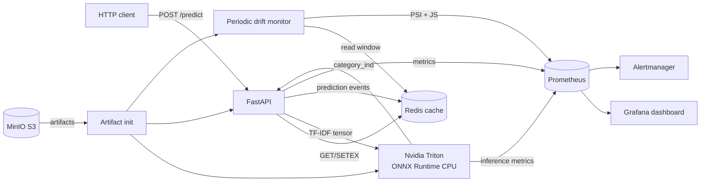

# Product Category Classifier

Production ML-сервис определяет категорию e-commerce товара по названию, описанию,
модели, типу и производителю. Классификатор обучен на данных соревнования
**Production ML Spring 2026**.

- Kaggle public score: **0.32413**
- Kaggle private score: **0.36728**
- Презентация: [Project Defence](https://docs.google.com/presentation/d/1vJHVpzisIZw005Tedt9xLe-_SKw8X5LinBk3auJIfIE/edit)

- [Текст выступления и ответы на вопросы](docs/defence-speech.md)
- Оригинал проекта: [GitLab](https://gitlab.v-efimov.tech/production-ml-spring-2026/projects/m.babaev)

## Быстрый запуск

```bash
SERVICE_PORT=8088 ./run_service.sh
```

Скрипт скачивает артефакты из MinIO, собирает API и запускает Redis, Nvidia
Triton, API, drift monitor, Prometheus, Alertmanager и Grafana. Затем он ждёт
готовности сервиса.

Тестовый запрос:

```bash
curl -X POST http://localhost:8088/predict \
  -H 'Content-Type: application/json' \
  -d '{
    "url": "https://ormatek.com/catalog/krovati/product/krovat-como-veda-4/",
    "texts": {
      "name": "Мягкая Кровать Орматек Como Veda 4 140x190",
      "description": "Мягкая кровать с каретной пиковкой в изголовье",
      "model": "Кровать Como Veda 4",
      "type_prefix": "Кровать",
      "vendor": "Орматек"
    },
    "image_url": "http://d.mradx.net/ecomimg/example.jpeg"
  }'
```

Ответ:

```json
{"category_ind": 42}
```

Допускаются пустые или `null` текстовые поля. Поле `texts` обязательно.

```bash
./stop_service.sh
```


## Архитектура




- **FastAPI** — валидация контракта, подготовка текста и HTTP API.
- **Nvidia Triton** — CPU-инференс Logistic Regression в ONNX Runtime.
- **Redis** — кэш запросов с TTL и буфер событий для мониторинга.
- **Drift monitor** — периодический PSI длины текста и Jensen–Shannon distance
распределения предсказанных классов.
- **Prometheus/Grafana/Alertmanager** — метрики, dashboard и алерты.
- **MinIO** — внешнее хранение тяжёлых артефактов.


## HTTP API


### `POST /predict`

- `url: string` — URL карточки товара;
- `texts: object` — `name`, `description`, `model`, `type_prefix`, `vendor`;
- `image_url: string` — URL изображения.

Выход: `{"category_ind": integer}`.

### `GET /health`

Возвращает готовность Redis и Triton. `status=ok` означает готовность обеих
зависимостей.

### `GET /metrics`

Prometheus-метрики API. OpenAPI доступен на `/docs`.

## Модель и данные

Модель использует объединение полей:

```text
type_prefix vendor name model description
```

Это `TfidfVectorizer` (80 000 word unigram/bigram features) и многоклассовая
`LogisticRegression`. В API выполняется TF-IDF, а классификатор исполняется
Triton. Модель распознаёт 207 присутствующих в train классов.

Артефакты:

```text
s3://m.babaev/project/artifacts/v1/
├── model.onnx
├── vectorizer.joblib
├── metadata.json
└── reference_stats.json
```

Обучение и формирование Kaggle submission:

```bash
uv run python scripts/train.py \
  --train-data /path/to/train.parquet.snappy \
  --test-data /path/to/test.parquet.snappy \
  --output training-output
```

Конвертация воспроизводима:

```bash
uv sync
uv run python scripts/convert_to_onnx.py \
  --pipeline /path/to/model.pkl \
  --train-data /path/to/train.parquet.snappy \
  --output artifacts
```

Загрузка новой версии:

```bash
uv run python scripts/artifacts.py upload \
  --directory artifacts --bucket m.babaev --prefix project/artifacts/v1
```


## Мониторинг

После запуска:

- Grafana: [http://localhost:3000](http://localhost:3000), по умолчанию `admin/admin`;
- Prometheus: [http://localhost:9090](http://localhost:9090);
- Alertmanager: [http://localhost:9093](http://localhost:9093);
- Triton health: [http://localhost:8001/v2/health/ready](http://localhost:8001/v2/health/ready).

Основные метрики:

- `product_api_requests_total`;
- `product_api_request_duration_seconds`;
- `product_api_cache_operations_total`;
- `product_api_predictions_total`;
- `product_drift_score`;
- `product_drift_detected`;
- стандартные метрики Triton `nv_inference_*`.

Drift рассчитывается раз в 60 секунд по последним 1000 некэшированным запросам,
когда накоплено минимум 20 наблюдений. Порог PSI и Jensen–Shannon — `0.2`.

Алерты: недоступность API/Triton, доля ошибок выше 5%, p95 latency выше секунды
и обнаруженный drift.

## Конфигурация


| Переменная               | По умолчанию                   | Назначение                  |
| ------------------------ | ------------------------------ | --------------------------- |
| `SERVICE_PORT`           | `8000`                         | внешний порт API            |
| `AWS_ACCESS_KEY_ID`      | —                              | ключ MinIO/S3               |
| `AWS_SECRET_ACCESS_KEY`  | —                              | секрет MinIO/S3             |
| `S3_ENDPOINT_URL`        | `https://minio.v-efimov.tech`  | S3 API                      |
| `S3_BUCKET`              | `m.babaev`                     | бакет                       |
| `S3_PREFIX`              | `project/artifacts/v1`         | версия артефактов           |
| `CACHE_TTL_SECONDS`      | `3600`                         | TTL предсказания            |
| `DRIFT_INTERVAL_SECONDS` | `60`                           | период drift-процесса       |
| `DRIFT_MIN_SAMPLES`      | `20`                           | минимальная выборка         |
| `TRITON_IMAGE`           | compact CPU ONNX image `22.06` | образ Triton                |
| `TRITON_PLATFORM`        | `linux/amd64`                  | платформа Triton            |
| `TRITON_PORT`            | `8001`                         | локальный порт Triton       |
| `PROMETHEUS_PORT`        | `9090`                         | локальный порт Prometheus   |
| `ALERTMANAGER_PORT`      | `9093`                         | локальный порт Alertmanager |
| `GRAFANA_PORT`           | `3000`                         | локальный порт Grafana      |


Наружу открыт только `SERVICE_PORT`. Порты мониторинга слушают `127.0.0.1` и
переопределяются, если они уже заняты другим стеком:

```bash
SERVICE_PORT=8000 GRAFANA_PORT=3001 PROMETHEUS_PORT=9091 ./run_service.sh
```

Официальный образ можно выбрать так:

```bash
TRITON_IMAGE=nvcr.io/nvidia/tritonserver:25.05-py3 ./run_service.sh
```


## Разработка и CI/CD

```bash
uv sync
uv run ruff check .
uv run pytest
docker build -t product-category-api .
AWS_ACCESS_KEY_ID=x AWS_SECRET_ACCESS_KEY=x docker-compose config
```

Тесты покрывают контракт, preprocessing, кэш, ошибки, Triton-клиент и
drift-метрики. Минимальное покрытие — 90%. При переносе: 25 тестов прошли, покрытие 93,94%.
Шаблон GitHub Actions находится в [docs/ci/github-actions.yml](docs/ci/github-actions.yml);
он подготовлен, но не активирован из-за отсутствия разрешения `workflow` у текущего
GitHub-токена. Исходный GitLab CI запускает lint, тесты с
Cobertura-отчётом, сборку Docker-образа и проверку Compose.

## План развития

1. Добавить char-level TF-IDF и distillation более сильной модели.
2. Использовать изображение через CLIP и ансамбль текста/изображения.
3. Возвращать top-k категорий с калиброванным confidence.
4. Добавить feedback loop и автоматическое переобучение.

